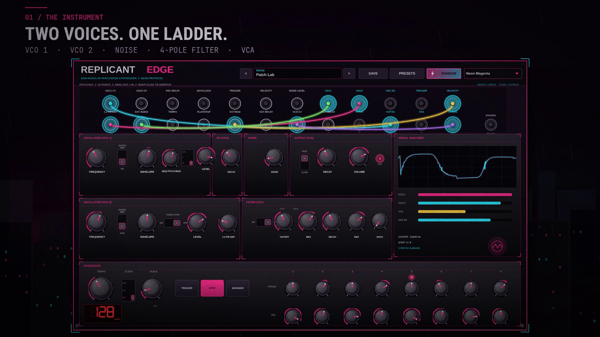
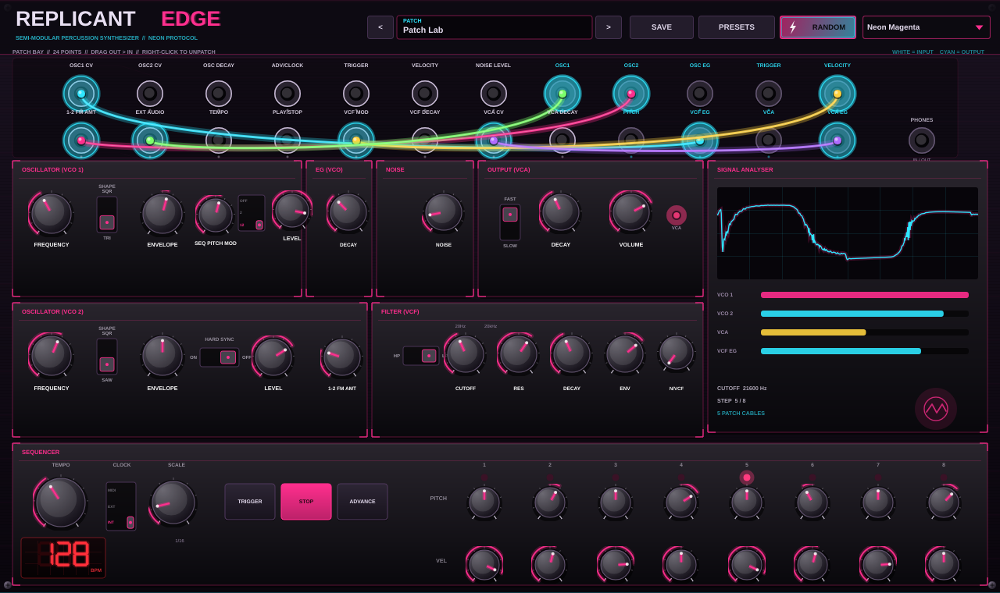
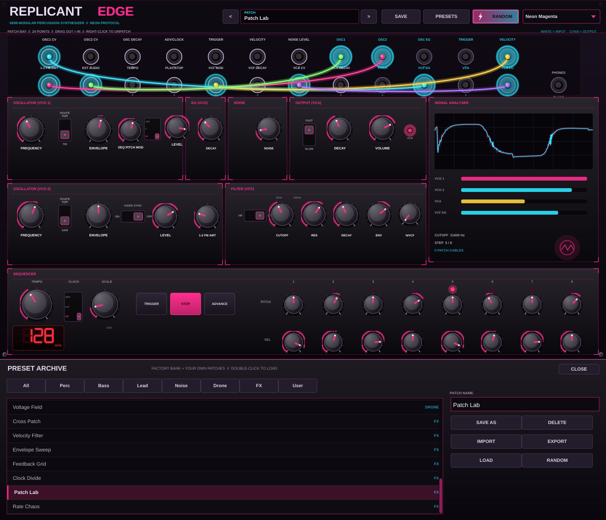
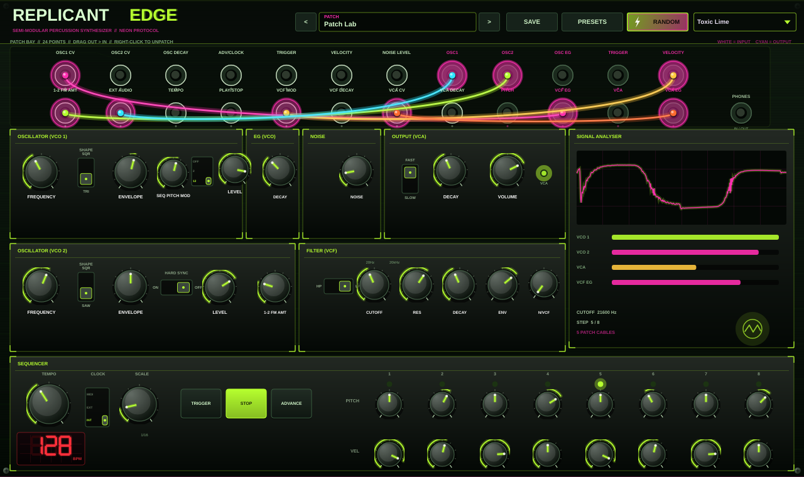
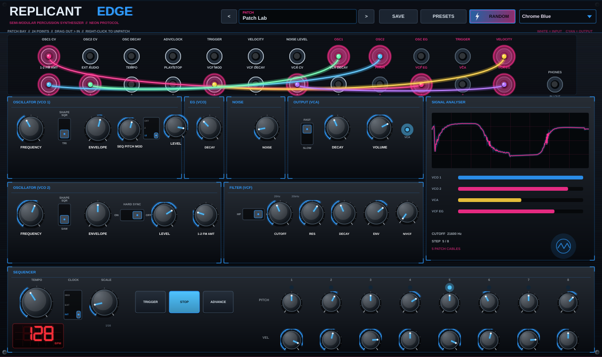

# REPLICANT EDGE // Cyberpunk Semi-Modular Percussion Synthesizer

<p align="center">
  <strong>Two Analog Voices, a 24-Point Patch Bay, an 8-Step Sequencer and a Preset Archive — Wrapped in a Neon Cyberpunk Panel</strong><br>
  <em>Audio Plugin: VST3 • AU • Standalone for macOS, Windows and Linux</em>
</p>

<p align="center">
  <a href="assets/replicantedgy_promo_1080p.mp4">
    
  </a>
</p>

<p align="center">
  <em>▶ Watch the 1080p promo — neon protocol.</em>
</p>

<p align="center">
  Replicant Edge is free and open source. If it earns a place in your setup and you
  feel like saying thanks, you can buy me a coffee — completely optional.
</p>

<p align="center">
  <a href="https://paypal.me/DanimanX?locale.x=en_US&amp;country.x=CL">
    
  </a>
</p>

<p align="center">
  <sub><a href="https://paypal.me/DanimanX?locale.x=en_US&amp;country.x=CL">paypal.me/DanimanX</a></sub>
</p>

---

<p align="center">
  
</p>

<p align="center">
  <em>Neon Magenta, the default skin, with the Patch Lab preset patched across the bay.</em>
</p>

---

## 🎛️ Overview

**Replicant Edge** is a virtual analog percussion synthesizer modelled on the
semi-modular **Behringer Edge / Moog DFAM** architecture: two oscillators, a
noise source, a four-pole ladder filter, three decay envelopes, a VCA and an
eight-step analog-style sequencer — plus a **24-point patch bay** that behaves
like the hardware, cables included.

The panel is drawn entirely in code and pushed through a cyberpunk palette:
black anodised chassis, neon magenta edge light, cyan instrumentation, glowing
cable runs and a live signal analyser. Three skins ship in the plugin.

> Replicant Edge is an original emulation inspired by the EDGE/DFAM hardware.
> It is not affiliated with, endorsed by or licensed from Behringer or Moog.

---

## ✨ Key Features

### ⚡ Two Analog Voices
* **VCO 1:** triangle / square, with envelope amount and sequencer pitch modulation.
* **VCO 2:** saw / square, with envelope amount, **hard sync** and **1-2 FM** into VCO 1.
* **Noise:** pink / white, mixable with an external audio patch point.
* **VCF:** four-pole transistor-ladder low-pass with resonance and self-oscillation,
  switchable to a resonant high-pass.
* **Three decay envelopes:** VCO pitch EG, VCF EG and VCA EG with **FAST / SLOW**
  VCA response.

### 🔌 24-Point Patch Bay
* Every jack printed on the hardware is here: **15 inputs and 9 outputs**.
* Drag from an output to an input to patch; right-click a jack (or a cable) to remove.
* CV is summed per destination, audio can be routed back into the filter, and a
  feedback patch is legal — it is resolved as a one-sample delay, never an
  algebraic loop.
* Cables glow with the signal they carry and are stored with the preset.

### 🥁 8-Step Sequencer
* **Pitch and velocity per step**, exactly like the hardware row. Both knobs are
  live: pitch bends the VCOs up to ±12 semitones through `SEQ PITCH MOD`, and
  velocity drives the VCA level and the VCF envelope.
* **Red LED tempo readout** under the TEMPO knob: a seven-segment display on a
  graticule grid. Click it to type an exact BPM, or scroll to nudge it by 0.5.
* **TRIGGER**, **PLAY/STOP** and **ADVANCE** buttons.
* Clock **1/32 … 1/4 plus triplets**, internal tempo, **host/MIDI sync** or
  **external clock** through the `ADV/CLOCK` jack.
* The sequencer drives the envelopes and both oscillators, and the `PITCH`,
  `TRIGGER` and `VELOCITY` outputs can be patched anywhere.

### 🗄️ Preset Archive
* **26 factory patches** across Perc, Bass, Lead, Noise, Drone and FX.
* **Save your own patches** by name; they are stored as `.edgy` files in the
  user preset folder and appear in the archive instantly.
* **IMPORT / EXPORT** share a single patch as a human-readable `.edgy` file.
* **RANDOM** (in the header, next to PRESETS) builds a complete cyberpunk patch
  in one click: voice archetype, filter, envelopes, a fresh eight-step line and
  a couple of patch cables. The archive has the same button as **MUTATED**.
* Presets are also exposed as **host programs**, so the DAW can browse them.

### 🎨 Three Cyberpunk Skins
* **Neon Magenta** — black chassis, magenta edge light, cyan instrumentation.
* **Toxic Lime** — acid green silkscreen with magenta wiring.
* **Chrome Blue** — brushed steel with electric blue and hot pink.

---

## 🔌 The Patch Bay

The bay follows the hardware layout. White labels are inputs, cyan labels are
outputs.

| Jack | Dir | Carries |
|---|---|---|
| `OSC1 CV` | in | VCO 1 pitch CV (1.0 = one octave) |
| `OSC2 CV` | in | VCO 2 pitch CV |
| `OSC DECAY` | in | CV over the VCO envelope decay |
| `ADV/CLOCK` | in | External clock: every rising edge advances a step |
| `TRIGGER` | in | Gate/trigger input for the envelopes |
| `VELOCITY` | in | Adds to the sequencer velocity |
| `NOISE LEVEL` | in | CV over the noise/external level |
| `1-2 FM AMT` | in | CV over the VCO 2 → VCO 1 FM depth |
| `EXT AUDIO` | in | Audio into the filter mixer (feedback allowed) |
| `TEMPO` | in | CV over the clock speed (±1 octave) |
| `PLAY/STOP` | in | Gate that starts/stops the transport |
| `VCF MOD` | in | CV over the filter cutoff |
| `VCF DECAY` | in | CV over the filter envelope decay |
| `VCA CV` | in | CV over the VCA gain |
| `VCA DECAY` | in | CV over the VCA envelope decay |
| `OSC1` | out | VCO 1 audio |
| `OSC2` | out | VCO 2 audio |
| `OSC EG` | out | VCO pitch envelope CV |
| `TRIGGER` | out | Sequencer trigger pulse |
| `VELOCITY` | out | Sequencer velocity CV |
| `PITCH` | out | Sequencer pitch CV |
| `VCF EG` | out | Filter envelope CV |
| `VCA` | out | Final audio output |
| `VCA EG` | out | VCA envelope CV |

Cable rules:

* **output → input only**; the editor refuses anything else.
* Right-click a jack to remove every cable touching it, or right-click a cable
  to remove that one.
* Cables are monophonic CV/audio: several cables into one input sum.
* Feedback (`VCA` → `EXT AUDIO`, for example) is supported and clamped so it
  screams without exploding.

---

## 🥁 Sequencer & Clock

The sequencer row gives each of the eight steps a **pitch** knob (±12 semitones
through `SEQ PITCH MOD`) and a **velocity** knob (VCA and VCF envelope level).

* **TEMPO** runs 20–300 BPM.
* **SCALE** steps in `1/32`, `1/16`, `1/8`, `1/4`, `1/4T`, `1/8T`, `1/16T`, `1/32T`.
* **CLOCK** selects `INT` (internal), `MIDI` (host transport) or `EXT`
  (`ADV/CLOCK` jack).
* **TRIGGER** fires the envelopes without moving the step; **ADVANCE** moves one
  step; **PLAY/STOP** (or `Space`) runs the clock.
* MIDI notes play the voice chromatically and trigger the envelopes, so the
  plugin works as a playable instrument too.

---

## 🗄️ Preset Archive

<p align="center">
  
</p>

* **RANDOM** builds a new cyberpunk patch (voice, line and cables) straight from
  the header, and `MUTATED` in this drawer does the same.
* **26 factory patches:** `Neon Pulse`, `Chrome Rain`, `Razor Wire`,
  `Voltage Drop`, `Toxic Bloom`, `Acid Protocol`, `Sub Level`, `Chrome Sub`,
  `Dark Current`, `Neon Lead`, `Ghost Wire`, `Laser Grid`, `Chrome Solo`,
  `Static Rain`, `Pink Corridor`, `White Noise Hit`, `Reactor Hum`,
  `Obsidian Drone`, `Voltage Field`, `Cross Patch`, `Velocity Filter`,
  `Envelope Sweep`, `Feedback Grid`, `Clock Divide`, `Patch Lab`, `Rate Chaos`.
* **Categories:** All, Perc, Bass, Lead, Noise, Drone, FX, User.
* **SAVE AS** writes the live panel, the eight steps and the cables to
  `~/.config/ReplicantEdgy/Presets` (Linux), `~/Library/Application Support/...`
  (macOS) or `%APPDATA%\ReplicantEdgy\Presets` (Windows).
* **IMPORT / EXPORT** use the same `.edgy` XML format, so a patch is a single
  shareable file.
* The `presets/` folder in this repository contains all 26 factory patches as
  `.edgy` examples, generated by the plugin's own `PresetManager`.

Regenerate them with:

```bash
ninja -C build generate_presets
./build/generate_presets            # -> presets/<Category>/NN_Name.edgy
```

---

## 🎨 Skins

<p align="center">
  
  
</p>

<p align="center">
  <em>Toxic Lime (left) and Chrome Blue (right). Pick one from the header; the choice is saved with the project.</em>
</p>

---

## 📦 Downloads & Installation

Download pre-built packages from [Releases](https://github.com/DanimanX/ReplicantEdgy/releases).

* **macOS:** VST3 in `~/Library/Audio/Plug-Ins/VST3/`, AU in
  `~/Library/Audio/Plug-Ins/Components/`
* **Linux:** VST3 in `~/.vst3/ReplicantEdgy.vst3`
* **Windows:** VST3 in `C:\Program Files\Common Files\VST3\ReplicantEdgy.vst3`

---

## 🛠️ Building from Source

Requires **CMake 3.22+**, **Ninja** or **Make**, and a **C++20** compiler.
JUCE 8 is fetched automatically.

```bash
git clone https://github.com/DanimanX/ReplicantEdgy.git
cd ReplicantEdgy

cmake -B build -G Ninja -DCMAKE_BUILD_TYPE=Release
cmake --build build --parallel
```

### Tests

The headless suite (**122 checks**) covers the oscillators, noise, ladder
filter, envelopes, the sequencer clock (internal, host and external), the step
pitch/velocity wiring, the tempo readout, the patch bay routing and cable
rules, the full engine, the random mutation, the preset manager (factory, user,
export/import), the plugin state round-trip and the editor/drawer:

```bash
cmake --build build --target run_tests
./build/run_tests                 # macOS / Windows
xvfb-run -a ./build/run_tests     # Linux, without a display
```

### Screenshots

`generate_snapshot` renders the editor off-screen. It takes an output path, a
skin index, a drawer flag, a preset index and an optional tempo (useful to
review the LED readout):

```bash
cmake --build build --target generate_snapshot

./build/generate_snapshot assets/replicantedgy_ui_magenta.png 0 0 24
./build/generate_snapshot assets/replicantedgy_ui_lime.png    1 0 24
./build/generate_snapshot assets/replicantedgy_ui_blue.png    2 0 24
./build/generate_snapshot assets/replicantedgy_drawer.png     0 1 24
./build/generate_snapshot /tmp/tempo.png 0 0 24 143.5         # LED readout at 143.5 BPM
```

### Promo video

The 1080p / 74 s promo is built from the real panel screenshots and the
plugin's own demo render (`tools/make_promo.py`):

```bash
cmake --build build --target render_audio_demo
./build/render_audio_demo assets/replicantedgy_demo.wav
python3 tools/make_promo.py
```

The demo track itself (`render_audio_demo`) is the plugin running standalone:
the internal sequencer drives the voice while the arrangement steps through the
factory bank and sweeps the filter.

---

## 🤖 CI/CD

`.github/workflows/build.yml` builds VST3, AU (macOS) and Standalone on macOS,
Linux and Windows, runs the regression suite on Linux and checks that the
checked-in `presets/` files match the generator.

---

## 📄 License

Created by **DanimanX Studio**. Distributed under the **MIT License**.
